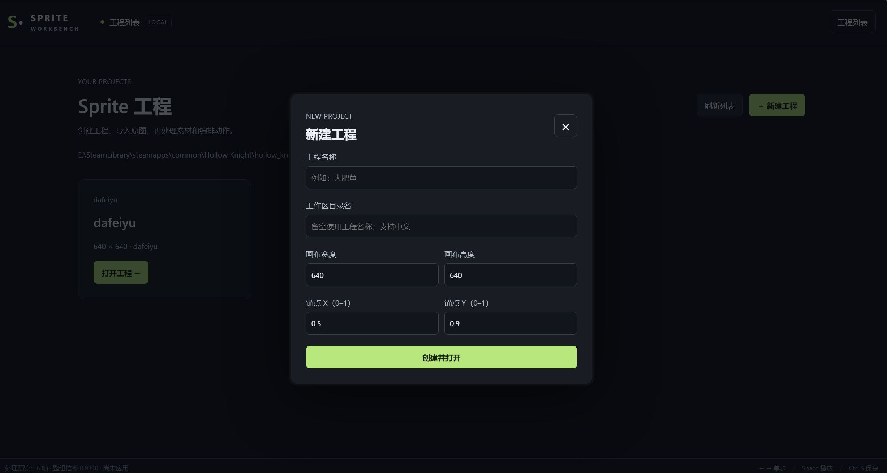
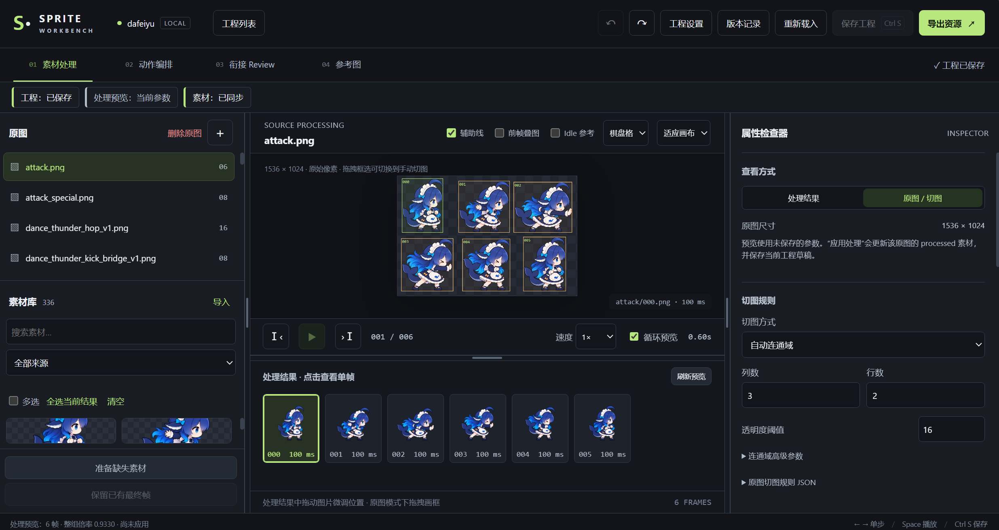
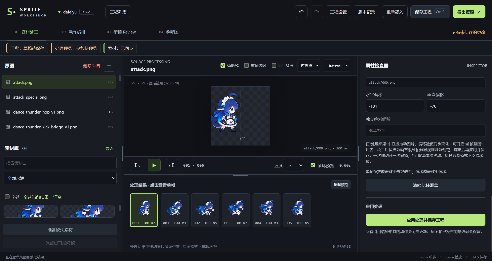
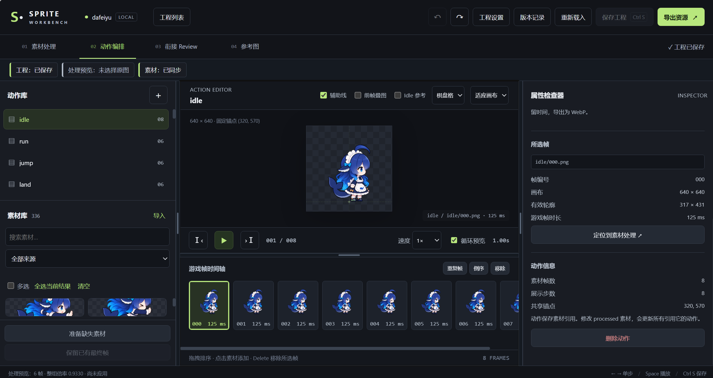
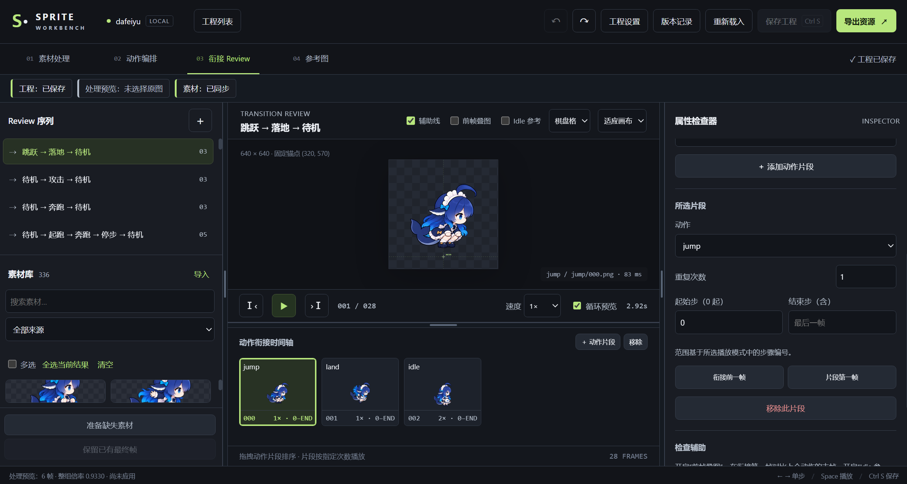

# 历史网页截图

> 早期页面展示，未随当前界面更新。当前布局与操作请看 [网页指南](../users/workbench.md)。

- 新建和配置项目

- 切割预览

> 默认自动连通域切割，支持手动切割

- 处理预览

> 可以调整单帧或整体的位置和大小：支持数值改动后位置预览 和 支持鼠标拖拽预览（数值实时更新）；调整完毕后点击按钮进行处理。

- 动作配置和预览

> 组合复用各种 sprites，确保动作的连贯性和流畅性。

- 动作间衔接预览

> 可以预览动作间的衔接效果，确保动作的连贯性和流畅性。
